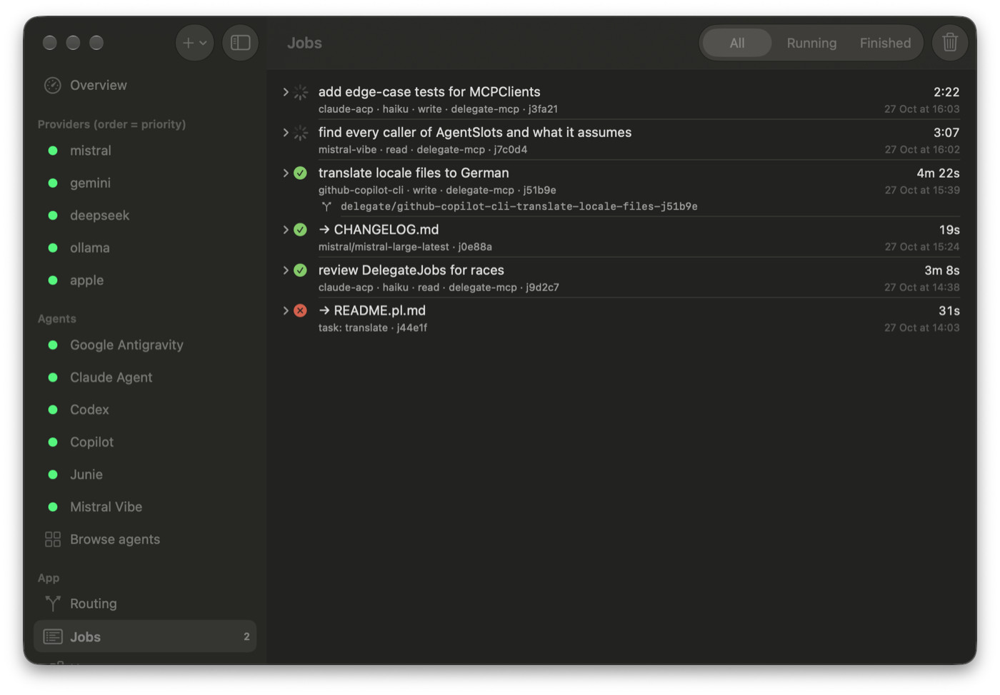
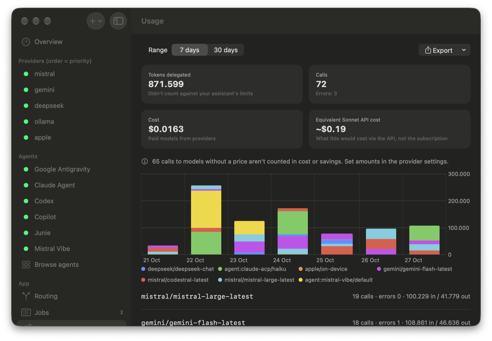
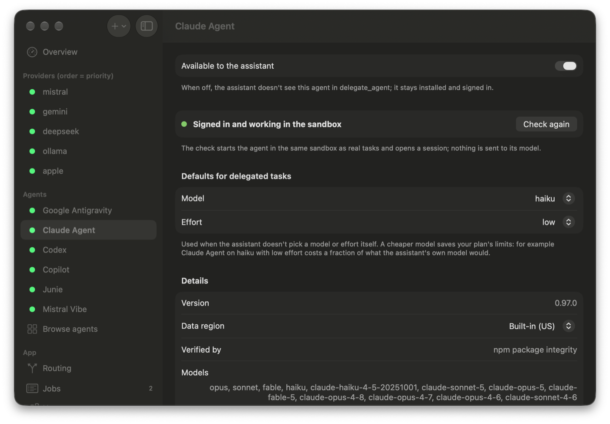
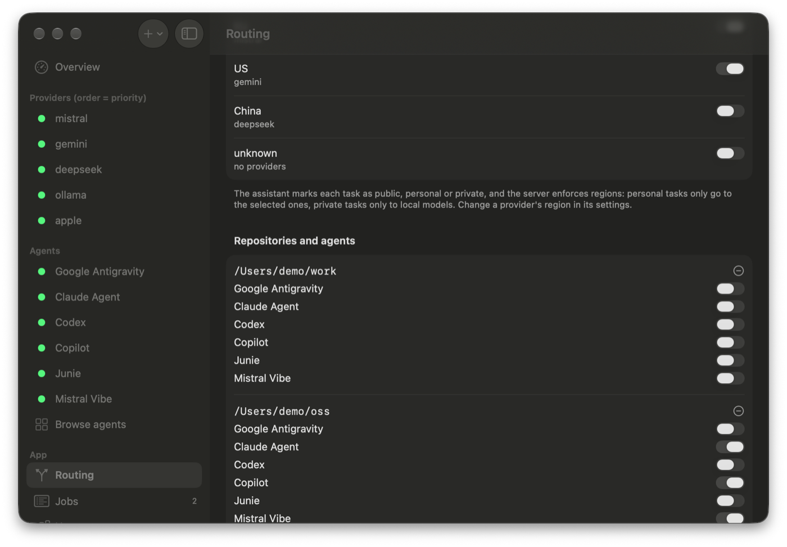
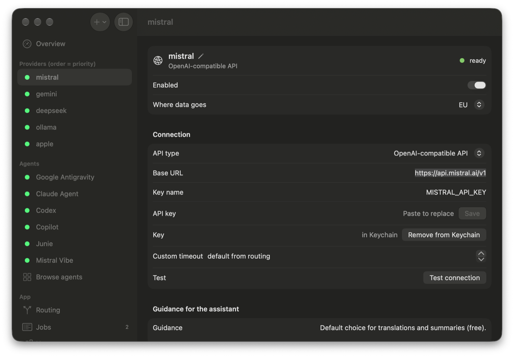

# Delegate MCP

[](https://github.com/lakafior/delegate-mcp/actions/workflows/ci.yml)
[]()
[]()
[]()

> **Delegate** is a native macOS menu bar app and stdio [Model Context Protocol (MCP)](https://modelcontextprotocol.io) server that lets your AI assistant (Claude, Codex, Cursor, VS Code, Gemini CLI, Antigravity, Zed) delegate standalone tasks to cheaper, faster, or local AI models with automated fallback, cost tracking, and secret leak prevention.

**Website:** [delegate.smigi.net](https://delegate.smigi.net) · **Download:** [latest release](https://github.com/lakafior/delegate-mcp/releases/latest)

<p align="center">
  
</p>

---

## 🚀 Why Delegate?

When working with AI assistants, many tasks—such as code boilerplate generation, unit test drafting, bulk translations, text summaries, or sanity checks—do not require expensive frontier models.

**Delegate** empowers your assistant to act as an orchestrator:
1. **Intelligent Fallback**: Define provider priority in `delegate.toml`. If a provider hits a rate limit, runs out of balance, or fails, Delegate automatically falls over to the next available provider.
2. **Cost Tracking & ROI Calculator**: Tracks exact token usage, calculates actual costs per query in USD, and shows live savings compared to a Sonnet-class API price benchmark ($3/$15 per 1M tokens).
3. **Coding Agents (ACP)**: Install agents from the ACP registry (Claude Agent, Codex, GitHub Copilot, Mistral Vibe, Google Antigravity, Junie) that run in the background on git repositories inside macOS sandboxes, keeping your original repo and API keys hidden.
4. **Data Leak Prevention (DLP)**: Pre-flight secret leak detector inspects prompts before dispatching them to external APIs, blocking accidental transmission of API keys, Bearer tokens, and AWS/GitHub credentials.
5. **Native macOS Experience**: Written entirely in modern Swift 6 with SwiftUI. No Python, Node.js, or runtime bloat. Includes a menu bar app with quick connection tests, real-time health diagnostics, and Keychain integration.
6. **Broad Model & Protocol Support**: OpenAI-compatible APIs (Mistral, DeepSeek, OpenRouter, Cerebras, Groq), Google Gemini, Anthropic Messages API, local engines (Ollama, LM Studio, vLLM), and offline Apple Intelligence Foundation Models.

### 📸 Screenshots

| | |
|---|---|
|  |  |
| **Usage**: tokens, calls and cost per model, with the equivalent API price | **Agents**: sign-in check in the sandbox, default model and effort |
|  |  |
| **Routing**: data regions and which agents may touch which repository | **Providers**: region, connection, key in Keychain, guidance for the assistant |

---

## 🛠️ MCP Tools Exposed to Your Assistant

| Tool | Description |
|---|---|
| `delegate` | Sends a prompt to a target model (`provider/model`), tag (e.g. `code`, `translate`), or top priority. Supports `json: true`, custom `system`, temperature, max tokens, automatic fallback, `sensitivity` (public/personal/private), `files` (text file paths the server reads), `output_file` (server writes response to disk), and `background` (immediately returns job ID). |
| `list_models` | Lists all configured providers and models ordered by priority, along with tags, pricing, key status, and routing guidance. Also shows installed coding agents with their default models and effort levels. |
| `list_remote_models` | Queries provider APIs directly for current model IDs, heuristic tags, context limits, and pricing. |
| `update_models` | Upserts model tags and pricing directly in `delegate.toml`. |
| `usage_summary` | Returns a breakdown of calls, tokens, total USD spend, and savings vs Sonnet benchmark. |
| `delegate_result` | Checks status and retrieves results of background jobs (IDs, wait up to 40s). |
| `delegate_agent` | Runs a coding agent on a git repository (read or write mode). Only visible when agents are installed. |

---

## 🤖 Coding Agents (ACP)

Install agents from the ACP registry (like in Zed) directly from the app:
- **Examples**: Claude Agent, Codex, GitHub Copilot, Mistral Vibe, Google Antigravity, Junie
- **Security**: Each agent runs in a macOS sandbox (`sandbox-exec`) on a snapshot of your git repository, with your original repo and API keys hidden
- **Read Mode**: For analysis and repo-wide searches (agent can read files but not modify them)
- **Write Mode**: Works in a git worktree on a new branch `delegate/<agent>-<task>-<id>`. The server commits changes, and your assistant reviews the diff before merging or discarding. Use `branch_from` for follow-up rounds.
- **Settings**: Per-agent default model and effort level (e.g., Claude Agent with haiku/low saves your main subscription), data region, and on/off switch
- **Repository Rules**: Per-repository allow rules to control which agents can access which projects
- **Parallel Limits**: `max_parallel_agents` (default 3) prevents overloading your system
- **Installation**: Verified by SHA-256 from the registry or Developer ID signature. npm agents are installed once via system Node.

---

## 🧑‍✈️ Conductor mode: /swarm

A Claude Code skill installed from the app's Overview that:
- Splits a goal (e.g., a roadmap item) into independent tasks
- Runs them in parallel on cheaper models and agents
- Reviews and merges the results

---

## 📋 Jobs tab

The app shows background jobs from all sessions:
- Running, finished, and interrupted jobs
- Agent/model, repository, mode, duration, result, and branch
- Copyable review/merge/discard commands
- Jobs are kept for 7 days

---

## 🔐 Privacy, budget and routing

- **Data Regions**: Every provider and agent has a region (local/eu/us/cn/other), inferred from its host or set by you
- **Sensitivity Levels**: `public`/`personal`/`private` to control which providers can handle your data
- **Daily Budget**: `daily_budget_usd` to cap spending on paid models
- **Automatic Cooldowns**: Models that hit rate limits or errors are paused for a while (from 60 s to a week, depending on the error) instead of eating the time limit
- **Delegation Mode**: `conservative`/`balanced`/`aggressive` to control how aggressively your assistant delegates tasks

---

## 📦 Requirements

- macOS 26.0 or newer
- Xcode 26+ with Swift 6.2+ (only to build from source)
- Your preferred AI assistant (Claude Desktop, Claude Code, Codex, Cursor, VS Code, Gemini CLI, Antigravity, Zed)

---

## ⚡ Quick Start

### Option 1: Download
1. Download the notarized `Delegate-<version>.dmg` from [GitHub Releases](https://github.com/lakafior/delegate-mcp/releases)
2. Drag to Applications
3. Open Delegate and go to Overview → Install for your assistant

### Option 2: Build from source

```bash
# Clone the repository
git clone https://github.com/lakafior/delegate-mcp.git
cd delegate-mcp

# Build CLI and Menu Bar App
./scripts/build-app.sh
```

The compiled application will be located in `dist/Delegate.app`, containing both the menu bar app and the bundled `delegate-mcp` server.

### Configuration

The app's Overview provides one-click installation for:
- Claude Desktop
- Claude Code
- Other assistants (Codex, Cursor, VS Code, Gemini CLI, Antigravity)
- Zed requires manual configuration (its settings file contains comments)

---

## ⚙️ Configuration (`delegate.toml`)

Configuration is stored at `~/Library/Application Support/Delegate/delegate.toml` (override with `$DELEGATE_HOME`).

Example configuration:

```toml
# Priority order is determined by the appearance of [[provider]] blocks.
timeout_seconds = 120
daily_budget_usd = 10.0
delegation_mode = "balanced"

routing_guidance = """
Delegate self-contained tasks: boilerplate generation, translations, first drafts,
summaries of pasted text, second opinion on code snippets. Always verify output.
"""

[[provider]]
id = "mistral"
type = "openai"
base_url = "https://api.mistral.ai/v1"
api_key_env = "MISTRAL_API_KEY"
privacy = "eu"

[[provider.model]]
id = "codestral-latest"
tags = ["code"]
cost = "free"

[[provider]]
id = "gemini"
type = "gemini"
base_url = "https://generativelanguage.googleapis.com/v1beta"
api_key_env = "GEMINI_API_KEY"
privacy = "us"

[[provider.model]]
id = "gemini-flash-latest"
tags = ["general", "translate", "summarize"]
cost = "free"

[[provider]]
id = "ollama"
type = "openai"
base_url = "http://localhost:11434/v1"
api_key_env = "" # Empty api_key_env means no authentication required
privacy = "local"

[[provider.model]]
id = "llama3.2:latest"
tags = ["local", "offline"]
cost = "free"

[[provider]]
id = "apple"
type = "foundation" # On-device Apple Intelligence
privacy = "local"

[[provider.model]]
id = "on-device"
tags = ["private", "offline", "short"]
cost = "free"

# Coding agent defaults: used when the assistant doesn't pick a model or effort.
[[agent]]
id = "claude-acp"
model = "haiku"
effort = "low"
enabled = true
privacy = "us"

# Repository rules: the longest matching path wins; an empty list means no agent may touch it.
[[repo]]
path = "/Users/me/work"
agents = []

[[repo]]
path = "/Users/me/oss"
agents = ["claude-acp", "github-copilot-cli"]
```

### Managing Providers in GUI

- **Add Provider**: Click `+` in the Settings window and pick a preset (Mistral, Gemini, DeepSeek, OpenRouter, Anthropic, Ollama, LM Studio, or a custom OpenAI-compatible API). A fresh install starts with only the on-device Apple model.
- **Rename Provider**: Click the pencil icon next to the provider title or right-click the provider in the sidebar and choose **Rename…**. The stored API key moves with it.
- **Reorder Priority**: Drag and drop providers in the sidebar list.
- **API Keys**: Stored securely in macOS Keychain with access control list (ACL) configured so the MCP helper process can read them seamlessly.
- **Agents**: Install, configure, and manage coding agents from the sidebar

---

## 🧭 How the assistant learns when to delegate

On startup the server sends MCP server instructions generated from your config: when to delegate, what never to send, and which ready models handle each task tag. MCP clients such as Claude Code and Claude Desktop add them to every session, so no configuration edits are needed. Optionally, **Overview → Claude** adds a short reminder block to `~/.claude/CLAUDE.md`. Restart your assistant after changing providers so the instructions refresh.

---

## 🩺 Diagnostics & Doctor

Run the built-in diagnostic doctor from your terminal:

```bash
./dist/Delegate.app/Contents/Helpers/delegate-mcp doctor
```

Output checks:
- Configuration file validity and syntax
- API keys existence in Keychain or environment
- Live network connectivity and latency (ms) to each provider endpoint
- Apple Intelligence / on-device model availability
- Claude Desktop and Claude Code integration status

---

## 🧪 Testing

Run the test suite using SwiftPM:

```bash
swift test
```

---

## 🚢 Releasing

1. Bump `let version` in `Sources/delegate-mcp/main.swift`
2. Commit your changes
3. Push a tag: `git tag v<version> && git push origin v<version>`
4. The GitHub workflow will:
   - Run tests
   - Sign the app with Developer ID
   - Notarize the app and DMG
   - Publish the release with `Delegate-<version>.dmg` and its SHA-256 checksum

---

## 🤝 Contributing

Contributions are warmly welcomed! Please see [CONTRIBUTING.md](CONTRIBUTING.md) for details on code style, testing, and pull request procedures.

---

## 📄 License

This project is licensed under the MIT License. See [LICENSE](LICENSE) for details.